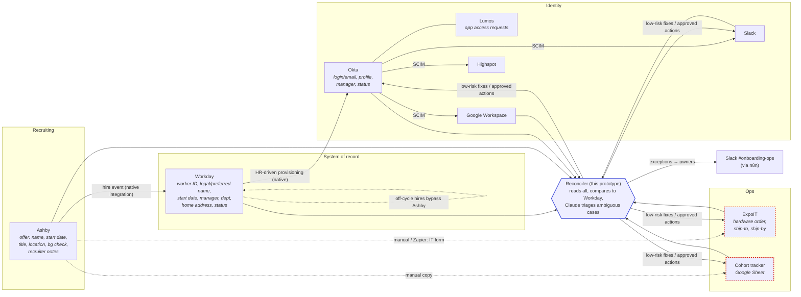

# Systems map: new-hire onboarding

## Where the data lives and how it moves

Solid arrows are native integrations BetterUp already owns. Dotted arrows are manual or Zapier handoffs, and those are where most of the breakage happens.

## Where it breaks today

| # | Break point | Example | Today | Caught by |
|---|---|---|---|---|
| 1 | **A change after the offer doesn't propagate** | Start date moves in Workday, but Okta, ExpoIT ship-by and the tracker keep the old date | Someone notices on day 1 | `field_drift` |
| 2 | **Change made in the wrong system** | Recruiter pushes the start date in Ashby after the Workday hire event, so Workday never hears about it | Nobody | `source_conflict` → Claude reads the recruiter note |
| 3 | **Bad data cascades** | A misspelled name ("Petrva") flows into the Okta email, the shipping label and the tracker. An invalid ZIP in Workday breaks the label | Found after the laptop bounces | `data_quality` at source + drift downstream |
| 4 | **Rescinded offer, live access** | Offer rescinded, but the Okta/Google/Slack accounts and the laptop order are still active | Security risk, wasted hardware | `access_after_rescind` (critical) |
| 5 | **Off-cycle hire** | Worker created directly in Workday, so there's no offer record, no background check tracking, and no tracker row | Invisible | `off_cycle_hire` |
| 6 | **Unwatched gates** | Okta provisioning, IT hardware form and background check are due ~7–10 days before start | Chased by hand, if at all | `gate_at_risk` / `gate_breach` |
| 7 | **Identity drift** | IT hand-creates a Slack account under a different email; contractor accounts with no worker | Accumulates silently | `identity_ambiguous` / `orphan_account` → Claude |

## The slice I built: cross-system validation (reconciliation)

I chose a reconciler that reads every system, compares each one to Workday (Ashby is used for offer terms and gates), and routes every discrepancy to a fix, an approval or an owner.

**Why this slice over the other two:**
- **Change propagation** is mostly already bought. Ashby→Workday and Workday→Okta→SCIM are native integrations. Rebuilding them would duplicate the stack, and the constraint is to get more out of it. Propagation also only fixes the paths you build. It does nothing about manual edits, off-cycle hires, or a zap that silently failed.
- **Exception monitoring** without validation has nothing to monitor. You need a definition of "wrong" first. Reconciliation produces exactly that, so the exception queue comes almost for free (findings dedupe, recur and auto-resolve).
- **Reconciliation is the cheapest way to cover all 7 break points.** It works regardless of *how* the data got wrong. It is idempotent by construction (it compares desired state to actual state), it's safe to run on a schedule, and its fix step is the propagation the native integrations don't do.
